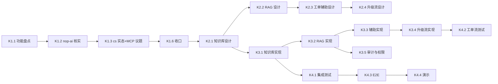

# AI 知识库 + 工单客服路线图（AI Knowledge & Ticket Roadmap）

> **Last Updated**: 2026-10-28
> **Source**: Gitee GVP 调研 2026-10-28（MaxKB / FastGPT 形态项目功能盘点）

## 1. 目的

本文件覆盖 AI 知识库 + 工单客服能力建设：对标 MaxKB/FastGPT 形态，复用 nop-entropy 平台 `nop-ai`（RAG/MCP/agent）与 `module-cs`（工单 + SLA + 知识库），交付知识库文档管理/向量化/RAG 问答、AI 辅助工单（自动分类/推荐回复）、人工升级工作流。本文件遵循 `00-roadmap-authoring-guide.md`：里程碑为分组容器（无状态），只有工作项携带 `todo`/`ready`/`done`。

## 2. Work Item Status

| State | Count |
|-------|-------|
| todo  | 24    |
| ready | 0     |
| done  | 0     |

## 3. 框架/平台复用

| 能力 | 提供方式 |
|------|----------|
| AI 接入/RAG/agent | nop-entropy `nop-ai`（LLM 接入、RAG 管道、agent；MCP 能力按横切裁决处理） |
| 工单/SLA/知识库 | `module-cs`（erp-cs-*：Ticket 登记→SLA→分派→解决关闭；status: NEW/ASSIGNED/IN_PROGRESS/RESOLVED/CLOSED/CANCELLED） |
| 工作流/人工升级 | `nop-wf`（含 human-approval 门） |
| 文档存储 | `nop-file`（知识库原始文档载体） |
| 定时/队列 | `nop-job` + `NopSysEvent`（向量化管道异步步骤、SLA 计时） |
| 限流/护栏 | `IRateLimiter`（AI 频控）+ enforcement 栈 |
| 审批/审计 | Actionlog 范式（AI 操作审计对齐 E3.8 先例） |
| 代码生成 | ORM 唯一真相 → codegen |

## 4. 当前基线

- **module-cs**（活仓 ORM 模型头注释核实）：客户工单（Ticket）登记 → SLA 管理 → 分派处理 → 解决关闭全流程；工单核心状态机 NEW/ASSIGNED/IN_PROGRESS/RESOLVED/CLOSED/CANCELLED + docStatus/approveStatus 三轴分离。知识库实体存在度/完备度待活仓核实（M1 任务项）。
- **nop-ai**：平台 LLM 接入能力；RAG/向量化/MCP/agent 的当前版本实态需在 M1 调研中核对（平台能力，应用层不重建）。
- **既有裁决**：erp-enhancement-roadmap §8 登记「应用系统提供给 AI 的接口不通过 MCP（用户 2026-08-12 裁决）」——本 roadmap 涉及 MCP 的能力点（nop-ai MCP 面）须在 M1 调研后经人工重新裁决或沿用该裁决，M2 设计前冻结。
- **缺口**（对照 MaxKB/FastGPT）：无知识库文档管理面（上传/分段/向量化/检索测试）、无 RAG 问答入口、工单无 AI 自动分类/推荐回复、无 AI→人工升级工作流、无答案引用溯源展示。

## 5. Milestones

### Milestone K1 — 调研（对标功能盘点 + 能力差距分析）

| Work Item | 状态 | Owner Doc | 依赖 | 复用 |
|-----------|------|-----------|------|------|
| K1.1: MaxKB/FastGPT 形态功能盘点（知识库/检索/问答/工单辅助矩阵） | todo | `docs/analysis/ai-cs-survey/2026-10-28-maxkb-fastgpt-feature-matrix.md` (NEW) | — | erp-survey 报告范式 |
| K1.2: nop-ai 平台能力核实（RAG/向量化/MCP/agent 版本实态，活仓核对） | todo | `docs/analysis/ai-cs-survey/2026-10-28-nop-ai-capability-notes.md` (NEW) | K1.1 | nop-entropy 文档 |
| K1.3: module-cs 知识库/SLA 实态核实 + MCP 裁决议题整理 | todo | `docs/analysis/ai-cs-survey/2026-10-28-cs-and-mcp-adjudication.md` (NEW) | K1.2 | module-cs ORM 模型 |
| K1.4: 阶段深度审计（调研项对照 live repo 核对能力引用真实性、找 drift） | todo | `docs/audits/2026-XX-multi-audit-aics-k1.md` (NEW) | K1.1-K1.3 | — |
| K1.5: 阶段开放审计（独立 fresh sub-agent 会话开放评审，不复用执行者上下文） | todo | `docs/audits/2026-XX-open-audit-aics-k1.md` (NEW) | K1.4 | — |
| K1.6: 调研结论收口（MCP 裁决登记 + 范围冻结） | todo | 本文件 §8 + K1.3 owner doc | K1.4, K1.5 | — |

### Milestone K2 — 设计（数据模型 / API / 边界设计）

| Work Item | 状态 | Owner Doc | 依赖 | 复用 |
|-----------|------|-----------|------|------|
| K2.1: 知识库文档管理设计（上传/分段/版本/启用态；向量化管道与 nop-ai 衔接） | todo | `docs/design/ai-cs/knowledge-base-design.md` (NEW) | K1.6 | nop-file / nop-job / nop-ai |
| K2.2: RAG 问答设计（检索/重排/引用溯源/答案幻觉护栏/频控） | todo | `docs/design/ai-cs/rag-qa-design.md` (NEW) | K2.1 | nop-ai / IRateLimiter |
| K2.3: AI 辅助工单设计（自动分类/优先级建议/推荐回复/置信度门） | todo | `docs/design/ai-cs/ai-ticket-assist-design.md` (NEW) | K2.2 | module-cs Ticket 模型 |
| K2.4: 人工升级工作流设计（AI 不确定→人工接管→SLA 联动→回写知识库） | todo | `docs/design/ai-cs/handoff-workflow-design.md` (NEW) | K2.3 | nop-wf human-approval |
| K2.5: 阶段深度审计（设计对照 live repo 核对平台能力引用/既有裁决一致性） | todo | `docs/audits/2026-XX-multi-audit-aics-k2.md` (NEW) | K2.1-K2.4 | — |
| K2.6: 阶段开放审计（独立 fresh sub-agent 会话开放评审设计边界） | todo | `docs/audits/2026-XX-open-audit-aics-k2.md` (NEW) | K2.5 | — |

### Milestone K3 — 开发（原子工作项实施）

| Work Item | 状态 | Owner Doc | 依赖 | 复用 |
|-----------|------|-----------|------|------|
| K3.1: 知识库文档管理实现（文档 CRUD/分段/向量化作业/状态面） | todo | `knowledge-base-design.md` §实现节 | K2.6 | nop-file / nop-job / codegen |
| K3.2: RAG 问答实现（检索 API + 引用溯源 + 护栏 + 问答页面） | todo | `rag-qa-design.md` §实现节 | K3.1 | nop-ai |
| K3.3: 工单 AI 辅助实现（登记时自动分类 + 推荐回复挂载） | todo | `ai-ticket-assist-design.md` §实现节 | K3.2 | module-cs |
| K3.4: 人工升级工作流实现（不确定门 → nop-wf 人工接管 → 处理结果回写知识库） | todo | `handoff-workflow-design.md` §实现节 | K3.3 | nop-wf |
| K3.5: AI 操作审计与权限面（AI 动作审计事件 + role-row-filter 核实，对齐 E3 批 G1 缺口族教训） | todo | `docs/design/ai-cs/ai-audit-and-authz.md` (NEW) | K3.2 | Actionlog / enforcement 栈 |
| K3.6: 阶段深度审计 + 阶段开放审计（实现对照设计 contract 找 drift；开放审计独立会话） | todo | `docs/audits/2026-XX-multi-audit-aics-k3.md` + `2026-XX-open-audit-aics-k3.md` (NEW) | K3.1-K3.5 | — |

### Milestone K4 — 验证（集成测试 / E2E / 演示）

| Work Item | 状态 | Owner Doc | 依赖 | 复用 |
|-----------|------|-----------|------|------|
| K4.1: 知识库/向量化集成测试（文档→分段→向量→检索命中断言） | todo | K2.1/K2.2 owner doc 验证节 | K3.6 | JUnit 范式 |
| K4.2: 工单辅助/升级流集成测试（分类落账、置信度门、wf 接管、SLA 联动） | todo | K2.3/K2.4 owner doc 验证节 | K3.6 | JUnit 范式 |
| K4.3: 端到端 E2E（提问→RAG 引用回答→转人工→回写知识库）+ 鉴权拒绝路径 | todo | `rag-qa-design.md` 验证节 | K4.1, K4.2 | Playwright |
| K4.4: 演示场景与数据脚本（MaxKB 形态对照 demo） | todo | `docs/design/ai-cs/ai-cs-demo-scenario.md` (NEW) | K4.3 | app-erp-test-data |
| K4.5: 阶段深度审计（验证覆盖对照 live repo 测试实态核对） | todo | `docs/audits/2026-XX-multi-audit-aics-k4.md` (NEW) | K4.1-K4.3 | known-good-baselines |
| K4.6: 阶段开放审计（独立 fresh sub-agent 会话开放评审验证充分性） | todo | `docs/audits/2026-XX-open-audit-aics-k4.md` (NEW) | K4.5 | — |

## 6. Work Item Details

| Work Item | Deliverables |
|-----------|-------------|
| K1.1 | 对标功能矩阵（MaxKB/FastGPT 功能逐项登记 + 归属裁决建议） |
| K1.2 | nop-ai 能力注记（RAG/向量化/MCP/agent 实态、版本缺口、可复用面清单） |
| K1.3 | cs 实态核实注记 + MCP 裁决议题清单（对照 2026-08-12 既有裁决） |
| K1.4/K1.5/K2.5/K2.6/K3.6/K4.5/K4.6 | 审计报告（multi-audit + open-audit，每阶段一对） |
| K1.6 | 收口注记（MCP 裁决登记 + 范围冻结清单） |
| K2.1-K2.4 | 各专题设计文档（含 ORM 变更清单待授权、护栏与频控边界） |
| K3.1-K3.5 | 各设计对应实现切片，每项一次交付可完成 |
| K4.1-K4.4 | 测试与演示交付物 |

## 7. 依赖图

## 8. 横切关注点

- **MCP 裁决前置**：2026-08-12 既有裁决（应用与平台 AI 接口不经 MCP）与本 roadmap 的 nop-ai MCP 能力点可能冲突——K1.6 人工裁决前，任何 MCP 相关设计/实现不得启动。
- **平台优先**：RAG/LLM/agent 能力优先复用 nop-ai，应用层不重建推理栈；nop-file/nop-job/nop-wf 同理。
- **AI 安全**：频控（IRateLimiter）、答案护栏、引用溯源、AI 操作审计、数据权限（role-row-filter 直连绕过 G1 缺口族教训）为强制横切项。
- **ORM 授权**：知识库实体/向量引用等 ORM 变更在整体计划中显式列出并走 dual-agent-approval。
- **审计纪律**：每阶段深度审计（对照 live repo）+ 开放审计（fresh sub-agent）强制。
- **状态只在工作项**：里程碑（K1-K4）无状态。

## 9. Rules

1. 遵循 `00-roadmap-authoring-guide.md` 状态跟踪；AI 按顺序取第一个 `todo` 项。
2. 实施以 `docs/plans/` 计划承载，含独立草案审查与独立结束审计。
3. 发现新复用机会更新 §3；Last Updated 随实质更新刷新。
