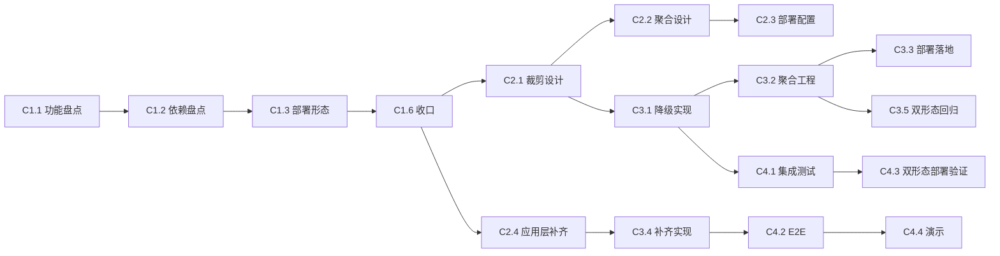

# CRM 独立应用路线图（CRM Standalone App Roadmap）

> **Last Updated**: 2026-10-28
> **Source**: Gitee GVP 调研 2026-10-28（若依系 CRM 项目功能盘点）

## 1. 目的

本文件覆盖 CRM/销售漏斗**独立应用**建设：以既有 `module-crm`（线索→商机→报价、评分、预测、区域配额）为底座，对标若依系 CRM 项目形态，将 CRM 从 ERP 全量依赖中**裁薄**为可独立部署的 app——依赖裁剪、独立聚合工程、独立部署配置。本文件遵循 `00-roadmap-authoring-guide.md`：里程碑为分组容器（无状态），只有工作项携带 `todo`/`ready`/`done`。

## 2. Work Item Status

| State | Count |
|-------|-------|
| todo  | 24    |
| ready | 0     |
| done  | 0     |

## 3. 框架/平台复用

| 能力 | 提供方式 |
|------|----------|
| CRM 业务模型 | `module-crm`（erp-crm-*：线索/漏斗阶段/商机/报价/活动历史/日历/营销归因/团队协作；Lead 三轴状态 docStatus/stageId/leadType） |
| 主数据 | `module-master-data`（Party/客户；裁剪分析对象） |
| 独立部署形态 | 既有 19 分域 app 独立工件范式（`schema-introspection.enabled` 配置、分域 app-erp-* 工件先例） |
| 工作流/审批 | `nop-wf`（报价审批） |
| 报表/看板 | `nop-report` + `getDashboardKpi`（销售漏斗 KPI） |
| 通知 | `module-notify`（线索分派/跟进提醒） |
| 权限 | enforcement 栈（role-row-filter/action auth） |
| 代码生成 | ORM 唯一真相 → codegen（不手改生成代码） |

## 4. 当前基线

- **module-crm**（活仓 ORM 模型头注释核实）：线索获取 → 跟进 → 转化商机 → 漏斗阶段管理 → 转化销售报价单全流程；活动历史（Event/Meeting）、日历管理、营销活动归因（UTM）、团队协作；Lead 三轴状态分离（docStatus: NEW/QUALIFIED/CONVERTED/LOST/CANCELLED；stageId 漏斗阶段；leadType LEAD/OPPORTUNITY 判别非两表）。
- **部署实态**：CRM 当前作为 ERP 分域 app 之一（app-erp-crm 工件），与 master-data/finance/sales 等存在跨工程依赖（跨工程走 I*Biz，不做 ORM 强引用）。
- **缺口**（对照若依系 CRM）：无独立聚合工程（CRM-only 启动面）、依赖未裁剪（哪些域强依赖/可降级未盘点）、无独立部署配置文档、漏斗可视化/评分/预测/区域配额的应用层暴露程度待核实。

## 5. Milestones

### Milestone C1 — 调研（对标功能盘点 + 能力差距分析）

| Work Item | 状态 | Owner Doc | 依赖 | 复用 |
|-----------|------|-----------|------|------|
| C1.1: 若依系 CRM 功能盘点（线索/商机/漏斗/报价/报表矩阵） | todo | `docs/analysis/crm-survey/2026-10-28-rjscrm-feature-matrix.md` (NEW) | — | erp-survey 报告范式 |
| C1.2: module-crm 依赖盘点（跨工程 I*Biz 依赖清单 + 强弱分级） | todo | `docs/analysis/crm-survey/2026-10-28-dependency-census.md` (NEW) | C1.1 | data-dependency-matrix.md |
| C1.3: 独立部署形态调研（分域 app 工件范式对 CRM 的适配与裁剪点） | todo | `docs/analysis/crm-survey/2026-10-28-standalone-deployment-notes.md` (NEW) | C1.2 | 19 分域 app 先例 |
| C1.4: 阶段深度审计（调研项对照 live repo 核对依赖/能力引用真实性、找 drift） | todo | `docs/audits/2026-XX-multi-audit-crm-c1.md` (NEW) | C1.1-C1.3 | — |
| C1.5: 阶段开放审计（独立 fresh sub-agent 会话开放评审，不复用执行者上下文） | todo | `docs/audits/2026-XX-open-audit-crm-c1.md` (NEW) | C1.4 | — |
| C1.6: 调研结论收口与裁剪范围裁决登记 | todo | 本文件 §4 + C1.2 owner doc | C1.4, C1.5 | — |

### Milestone C2 — 设计（数据模型 / API / 边界设计）

| Work Item | 状态 | Owner Doc | 依赖 | 复用 |
|-----------|------|-----------|------|------|
| C2.1: 依赖裁剪设计（强依赖保留/弱依赖降级 SPI/可切依赖裁断清单） | todo | `docs/design/crm/standalone-dependency-trim.md` (NEW) | C1.6 | I*Biz 边界范式 |
| C2.2: 独立聚合工程设计（app-crm-standalone 工件、启动面、菜单/页面聚合） | todo | `docs/design/crm/standalone-aggregation.md` (NEW) | C2.1 | 分域 app 工件范式 |
| C2.3: 独立部署配置设计（数据源/迁移脚本/introspection/限流默认值） | todo | `docs/design/crm/standalone-deploy-config.md` (NEW) | C2.2 | deploy 目录先例 |
| C2.4: CRM 应用层补齐设计（漏斗看板/评分展示/预测/区域配额界面化） | todo | `docs/design/crm/app-layer-gap-design.md` (NEW) | C1.6 | nop-report / getDashboardKpi |
| C2.5: 阶段深度审计（设计对照 live repo 核对裁剪点/工件引用真实性） | todo | `docs/audits/2026-XX-multi-audit-crm-c2.md` (NEW) | C2.1-C2.4 | — |
| C2.6: 阶段开放审计（独立 fresh sub-agent 会话开放评审设计边界） | todo | `docs/audits/2026-XX-open-audit-crm-c2.md` (NEW) | C2.5 | — |

### Milestone C3 — 开发（原子工作项实施）

| Work Item | 状态 | Owner Doc | 依赖 | 复用 |
|-----------|------|-----------|------|------|
| C3.1: 弱依赖降级实现（可降级 I*Biz 依赖的 SPI/开关化） | todo | `standalone-dependency-trim.md` §实现节 | C2.6 | SPI 注入范式 |
| C3.2: 独立聚合工程搭建（app-crm-standalone 工件 + 启动 + 菜单聚合） | todo | `standalone-aggregation.md` §实现节 | C3.1 | app-erp-crm 工件 |
| C3.3: 独立部署配置落地（deploy 脚本/迁移/config 默认值） | todo | `standalone-deploy-config.md` §实现节 | C3.2 | deploy 目录范式 |
| C3.4: CRM 应用层补齐实现（漏斗看板/配额/评分界面） | todo | `app-layer-gap-design.md` §实现节 | C2.6 | AMIS 渲染 |
| C3.5: 双形态回归保障（app-erp-all 内 CRM 行为零回归） | todo | `standalone-aggregation.md` 验证节 | C3.2 | known-good-baselines |
| C3.6: 阶段深度审计 + 阶段开放审计（实现对照设计 contract 找 drift；开放审计独立会话） | todo | `docs/audits/2026-XX-multi-audit-crm-c3.md` + `2026-XX-open-audit-crm-c3.md` (NEW) | C3.1-C3.5 | — |

### Milestone C4 — 验证（集成测试 / E2E / 演示）

| Work Item | 状态 | Owner Doc | 依赖 | 复用 |
|-----------|------|-----------|------|------|
| C4.1: 独立启动/裁剪集成测试（standalone 工件可启动、降级路径生效） | todo | `standalone-dependency-trim.md` 验证节 | C3.6 | JUnit 范式 |
| C4.2: CRM 业务流 E2E（线索→商机→报价→漏斗看板） | todo | `app-layer-gap-design.md` 验证节 | C3.6 | Playwright |
| C4.3: 双形态部署验证（standalone 与 app-erp-all 各自全量测试绿） | todo | `standalone-deploy-config.md` 验证节 | C4.1 | known-good-baselines |
| C4.4: 演示场景与数据脚本（CRM 独立 app demo） | todo | `docs/design/crm/crm-demo-scenario.md` (NEW) | C4.2 | app-erp-test-data |
| C4.5: 阶段深度审计（验证覆盖对照 live repo 测试实态核对） | todo | `docs/audits/2026-XX-multi-audit-crm-c4.md` (NEW) | C4.1-C4.3 | known-good-baselines |
| C4.6: 阶段开放审计（独立 fresh sub-agent 会话开放评审验证充分性） | todo | `docs/audits/2026-XX-open-audit-crm-c4.md` (NEW) | C4.5 | — |

## 6. Work Item Details

| Work Item | Deliverables |
|-----------|-------------|
| C1.1 | 对标功能矩阵（若依系 CRM 功能逐项登记 + 归属裁决建议） |
| C1.2 | 依赖清单（crm→各域边逐条登记，强/弱/可裁三档分级） |
| C1.3 | 独立部署形态注记（可复用工件机制 + 缺口清单） |
| C1.4/C1.5/C2.5/C2.6/C3.6/C4.5/C4.6 | 审计报告（multi-audit + open-audit，每阶段一对） |
| C1.6 | 收口注记（裁剪范围冻结、触发条件登记） |
| C2.1 | 裁剪设计（每条依赖的处置决策 + 降级 SPI 契约） |
| C2.2/C2.3 | 工程与部署设计（工件清单、启动面、配置键） |
| C2.4 | 应用层补齐设计（漏斗/配额/评分的页面与 KPI 口径） |
| C3.1-C3.5 | 各设计对应实现切片，每项一次交付可完成 |
| C4.1-C4.4 | 测试与演示交付物 |

## 7. 依赖图

## 8. 横切关注点

- **不破坏 ERP 主形态**：独立 app 是新增工件，`app-erp-all` 内 CRM 行为必须零回归（C3.5 强制）。
- **审计纪律**：每阶段深度审计（对照 live repo）+ 开放审计（fresh sub-agent）强制，不通过不进下一阶段。
- **ORM 纪律**：如涉及 ORM 变更（预计裁剪以零 ORM 优先），在整体计划中显式列出并走 dual-agent-approval。
- **状态只在工作项**：里程碑（C1-C4）无状态。

## 9. Rules

1. 遵循 `00-roadmap-authoring-guide.md` 状态跟踪；AI 按顺序取第一个 `todo` 项。
2. 实施以 `docs/plans/` 计划承载，含独立草案审查与独立结束审计。
3. 发现新复用机会更新 §3；Last Updated 随实质更新刷新。
