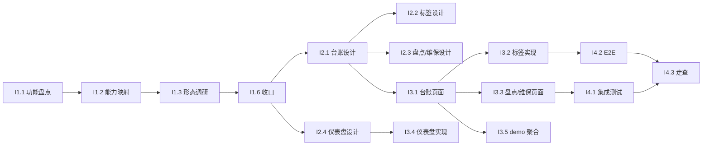

# IT 资产管理展示型 Demo App 路线图（ITAM IT-Asset Roadmap）

> **Last Updated**: 2026-10-28
> **Source**: Gitee GVP 调研 2026-10-28（chemex 咖啡壶 / GVP ITAM 类项目功能盘点）

## 1. 目的

本文件覆盖 IT 资产管理（ITAM）**展示型 demo app** 建设：对标 chemex（咖啡壶）/GVP ITAM 项目形态，复用既有 `module-assets`（资本化/折旧/处置），在**小体量可演示**约束下交付设备台账、盘点、维保、折旧展示、二维码标签。本文件遵循 `00-roadmap-authoring-guide.md`：里程碑为分组容器（无状态），只有工作项携带 `todo`/`ready`/`done`。

## 2. Work Item Status

| State | Count |
|-------|-------|
| todo  | 24    |
| ready | 0     |
| done  | 0     |

## 3. 框架/平台复用

| 能力 | 提供方式 |
|------|----------|
| 资产模型 | `module-assets`（erp-ast-*：资产卡片、类别、折旧计划、移动、价值调整、处置、资本化、CIP、拆分/合并；assetStatus 三轴之一） |
| 维保执行 | `module-maintenance`（维护计划/访问/请求/团队/停机记录——设备维护执行面已分工在 maintenance 域） |
| 审计轨迹 | `ErpAstAssetActionLog`（E3.8 已落地 7 事件类型） |
| 型号级扩展字段 | JsonOrmComponent ext 字段集（E3.3 已落地） |
| 报表/打印 | `nop-report`（二维码标签/清单打印） |
| 文件存储 | `nop-file`（设备图片/附件） |
| 页面渲染 | AMIS + `getDashboardKpi`（资产 KPI 看板既有 10 域 KPI） |
| 代码生成 | ORM 唯一真相 → codegen |

## 4. 当前基线

- **module-assets**：固定资产卡片、资产类别、折旧计划、资产移动、价值调整、处置、资本化、在建工程(CIP)、拆分、合并；折旧/调整/处置/资本化触发凭证生成（posted 联动）；审计轨迹 + 型号级 ext 字段集已落地（erp-enhancement-roadmap E3.3/E3.8）。
- **module-maintenance**：设备/资产维护执行（计划、访问、维修、停机），与 assets 域「价值管理 vs 实物维护」分工明确。
- **缺口**（对照 chemex/GVP ITAM）：无 IT 资产专属台账视图（设备型号/序列号/归属人/租期等 ITAM 视角字段面）、无二维码标签生成打印、盘点复用 StockTake 但无 ITAM 场景化页面、无轻量独立演示入口（当前为 ERP 分域页面）、折旧展示无 ITAM 风格仪表盘。

## 5. Milestones

### Milestone I1 — 调研（对标功能盘点 + 能力差距分析）

| Work Item | 状态 | Owner Doc | 依赖 | 复用 |
|-----------|------|-----------|------|------|
| I1.1: chemex/GVP ITAM 功能盘点（台账/盘点/维保/折旧/标签矩阵） | todo | `docs/analysis/itam-survey/2026-10-28-chemex-feature-matrix.md` (NEW) | — | erp-survey 报告范式 |
| I1.2: module-assets/maintenance 现有能力映射（ITAM 视角逐项对照） | todo | `docs/analysis/itam-survey/2026-10-28-gap-analysis.md` (NEW) | I1.1 | 两域 ORM 模型注释 |
| I1.3: demo 体量与形态裁决调研（独立工件 vs 分域页面聚合、演示口径） | todo | `docs/analysis/itam-survey/2026-10-28-demo-scope-notes.md` (NEW) | I1.2 | 分域 app 先例 |
| I1.4: 阶段深度审计（调研项对照 live repo 核对能力引用真实性、找 drift） | todo | `docs/audits/2026-XX-multi-audit-itam-i1.md` (NEW) | I1.1-I1.3 | — |
| I1.5: 阶段开放审计（独立 fresh sub-agent 会话开放评审，不复用执行者上下文） | todo | `docs/audits/2026-XX-open-audit-itam-i1.md` (NEW) | I1.4 | — |
| I1.6: 调研结论收口与 demo 范围冻结 | todo | 本文件 §4 + I1.3 owner doc | I1.4, I1.5 | — |

### Milestone I2 — 设计（数据模型 / API / 边界设计）

| Work Item | 状态 | Owner Doc | 依赖 | 复用 |
|-----------|------|-----------|------|------|
| I2.1: ITAM 台账视图设计（IT 视角字段面：型号/序列号/归属人/位置/租期；ext 字段优先零 ORM） | todo | `docs/design/itam/itam-ledger-view.md` (NEW) | I1.6 | JsonOrmComponent / E3.3 先例 |
| I2.2: 二维码标签设计（编码规则、生成、nop-report 打印模板、扫码落地页） | todo | `docs/design/itam/qr-label-design.md` (NEW) | I2.1 | nop-report / nop-file |
| I2.3: ITAM 盘点/维保场景设计（StockTake 场景化 + 维保请求入口） | todo | `docs/design/itam/itam-checkup-maintenance.md` (NEW) | I2.1 | StockTake 链 / module-maintenance |
| I2.4: 折旧/价值展示设计（ITAM 风格仪表盘 + KPI 口径对齐既有度量目录） | todo | `docs/design/itam/itam-dashboard.md` (NEW) | I1.6 | getDashboardKpi / dashboards.md |
| I2.5: 阶段深度审计（设计对照 live repo 核对字段/模板/KPI 引用真实性） | todo | `docs/audits/2026-XX-multi-audit-itam-i2.md` (NEW) | I2.1-I2.4 | — |
| I2.6: 阶段开放审计（独立 fresh sub-agent 会话开放评审设计边界） | todo | `docs/audits/2026-XX-open-audit-itam-i2.md` (NEW) | I2.5 | — |

### Milestone I3 — 开发（原子工作项实施）

| Work Item | 状态 | Owner Doc | 依赖 | 复用 |
|-----------|------|-----------|------|------|
| I3.1: ITAM 台账页面实现（设备列表/详情/筛选，ext 字段集挂载） | todo | `itam-ledger-view.md` §实现节 | I2.6 | AMIS / E3.3 页面范式 |
| I3.2: 二维码标签实现（生成 + 打印模板 + 扫码落地页） | todo | `qr-label-design.md` §实现节 | I3.1 | nop-report |
| I3.3: ITAM 盘点/维保页面实现（场景化盘点提交 + 报修入口） | todo | `itam-checkup-maintenance.md` §实现节 | I3.1 | StockTake / maintenance API |
| I3.4: 折旧/价值仪表盘实现（KPI 卡片 + 折旧曲线展示） | todo | `itam-dashboard.md` §实现节 | I2.6 | getDashboardKpi |
| I3.5: demo 聚合入口与种子数据（菜单聚合 + 演示数据脚本） | todo | `docs/design/itam/itam-demo-scenario.md` (NEW) | I3.1-I3.4 | app-erp-test-data |
| I3.6: 阶段深度审计 + 阶段开放审计（实现对照设计 contract 找 drift；开放审计独立会话） | todo | `docs/audits/2026-XX-multi-audit-itam-i3.md` + `2026-XX-open-audit-itam-i3.md` (NEW) | I3.1-I3.5 | — |

### Milestone I4 — 验证（集成测试 / E2E / 演示）

| Work Item | 状态 | Owner Doc | 依赖 | 复用 |
|-----------|------|-----------|------|------|
| I4.1: 台账/盘点集成测试（ext 字段、盘点提交、审计事件断言） | todo | I2.1/I2.3 owner doc 验证节 | I3.6 | JUnit 范式 |
| I4.2: 标签/仪表盘 E2E（打印模板渲染 + KPI 数值断言） | todo | I2.2/I2.4 owner doc 验证节 | I3.6 | Playwright |
| I4.3: demo 全流程走查（扫码→台账→盘点→报修→折旧展示脚本化） | todo | `itam-demo-scenario.md` | I4.1, I4.2 | — |
| I4.4: 小体量约束复核（页面/依赖数量、启动耗时、不引入新 ORM 溢出） | todo | I1.3 owner doc | I3.6 | — |
| I4.5: 阶段深度审计（验证覆盖对照 live repo 测试实态核对） | todo | `docs/audits/2026-XX-multi-audit-itam-i4.md` (NEW) | I4.1-I4.3 | known-good-baselines |
| I4.6: 阶段开放审计（独立 fresh sub-agent 会话开放评审验证充分性） | todo | `docs/audits/2026-XX-open-audit-itam-i4.md` (NEW) | I4.5 | — |

## 6. Work Item Details

| Work Item | Deliverables |
|-----------|-------------|
| I1.1 | 对标功能矩阵（chemex/GVP ITAM 功能逐项登记） |
| I1.2 | 能力映射表（既有域能力 → ITAM 术语逐项对照 + 缺口分级） |
| I1.3 | demo 形态注记（体量上限、演示口径、聚合方式裁决建议） |
| I1.4/I1.5/I2.5/I2.6/I3.6/I4.5/I4.6 | 审计报告（multi-audit + open-audit，每阶段一对） |
| I1.6 | 收口注记（demo 范围冻结清单） |
| I2.1-I2.4 | 各专题设计文档（字段面/标签/场景/仪表盘，零 ORM 优先） |
| I3.1-I3.5 | 各设计对应实现切片，每项一次交付可完成 |
| I4.1-I4.4 | 测试与演示交付物 |

## 7. 依赖图

## 8. 横切关注点

- **小体量纪律**：demo 不扩 ORM、不新建模块；优先 ext 字段 + 派生视图 + 页面聚合；任何 ORM 意图回到 I1.6 重裁。
- **域分工尊重**：价值管理归 assets、实物维护归 maintenance，不越界复制逻辑。
- **审计纪律**：每阶段深度审计（对照 live repo）+ 开放审计（fresh sub-agent）强制。
- **状态只在工作项**：里程碑（I1-I4）无状态。

## 9. Rules

1. 遵循 `00-roadmap-authoring-guide.md` 状态跟踪；AI 按顺序取第一个 `todo` 项。
2. 实施以 `docs/plans/` 计划承载，含独立草案审查与独立结束审计。
3. 发现新复用机会更新 §3；Last Updated 随实质更新刷新。
