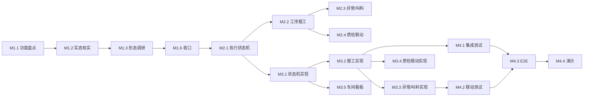

# MES 车间执行路线图（MES Shopfloor Roadmap）

> **Last Updated**: 2026-10-28
> **Source**: Gitee GVP 调研 2026-10-28（t3rik-erp 等开源 MES/ERP 一体化项目功能盘点）

## 1. 目的

本文件覆盖 MES 车间执行能力建设：对标 t3rik-erp 形态，复用 `module-manufacturing`（BOM/工艺路线/工单/工序作业卡/领料）、`module-aps`（排产/派工）、`module-quality`（质检）、`module-maintenance`（设备维护/停机），补齐**车间执行面**：生产工单执行、工序报工、车间异常/叫料、报工质检联动。本文件遵循 `00-roadmap-authoring-guide.md`：里程碑为分组容器（无状态），只有工作项携带 `todo`/`ready`/`done`。

## 2. Work Item Status

| State | Count |
|-------|-------|
| todo  | 24    |
| ready | 0     |
| done  | 0     |

## 3. 框架/平台复用

| 能力 | 提供方式 |
|------|----------|
| 制造主模型 | `module-manufacturing`（BOM 头/行/工艺/联副产品、工艺路线 Routing、工作中心、生产版本、工单 WorkOrder 头/多产出投入行、工序作业卡 JobCard、JobCardTimeLog、领料单 MaterialIssue、MRP、委外、标准成本滚算） |
| 排产/派工 | `module-aps`（工序工单状态机 DRAFT/PLANNED/IN_PROGRESS/FINISHED/CANCELLED/UNSCHEDULABLE；排产引擎 + E3.4 求解器分离先例） |
| 质检 | `module-quality`（质检单关联工单、质检模板/参数、NCR、CAPA、风险） |
| 设备/停机 | `module-maintenance`（维护计划/访问/停机记录，与制造域协作分工已有约定） |
| 库存写边 | `module-inventory`（领料出库/完工入库经库存域，跨工程走 I*Biz） |
| 页面/移动 | AMIS 渲染 + nop-chaos-flux `flux-renderers-mobile`（报工终端形态备选） |
| 审批 | `nop-wf` |
| 报表/KPI | `nop-report` + `getDashboardKpi` |
| 代码生成 | ORM 唯一真相 → codegen |

## 4. 当前基线

- **module-manufacturing**：BOM（头/行/工艺/联副产品）、工艺路线、工作中心、生产版本（BOM×Routing×有效期）、工单（头/多产出投入行）、工序作业卡 JobCard + 作业工时 JobCardTimeLog、领料单 MaterialIssue（头/行）、MRP（计划头/行/独立需求）、委外加工单、标准成本滚算。
- **module-aps**：工序级排产（工序工单状态机含 PLANNED/IN_PROGRESS/FINISHED）、排产引擎（贪心 + TOC 求解器分离试点 E3.4）。
- **module-quality**：质检单可关联工单、NCR/CAPA。
- **缺口**（对照 t3rik-erp）：工单执行面无「开工/完工」执行状态驱动（执行与排产状态混用待核实）、工序报工无报废/返工/工时结构化提交面、无车间异常（Andon 类）与叫料（pull signal）机制、报工→质检强制联动（首件/过程检/完工检触发）缺失、车间看板（工单进度/停机/异常）无车间视角聚合。

## 5. Milestones

### Milestone M1 — 调研（对标功能盘点 + 能力差距分析）

| Work Item | 状态 | Owner Doc | 依赖 | 复用 |
|-----------|------|-----------|------|------|
| M1.1: t3rik-erp 等对标功能盘点（工单执行/报工/异常/叫料/质检联动矩阵） | todo | `docs/analysis/mes-survey/2026-10-28-t3rik-feature-matrix.md` (NEW) | — | erp-survey 报告范式 |
| M1.2: mfg/aps/qa/mnt 四域执行面实态核实（JobCard/工时/状态机活仓核对） | todo | `docs/analysis/mes-survey/2026-10-28-execution-gap-analysis.md` (NEW) | M1.1 | 各域 ORM 模型注释 |
| M1.3: 车间终端形态与联动链调研（报工终端、叫料信号、质检触发点） | todo | `docs/analysis/mes-survey/2026-10-28-shopfloor-form-factor.md` (NEW) | M1.2 | flux-renderers-mobile |
| M1.4: 阶段深度审计（调研项对照 live repo 核对实体/状态机引用真实性、找 drift） | todo | `docs/audits/2026-XX-multi-audit-mes-m1.md` (NEW) | M1.1-M1.3 | — |
| M1.5: 阶段开放审计（独立 fresh sub-agent 会话开放评审，不复用执行者上下文） | todo | `docs/audits/2026-XX-open-audit-mes-m1.md` (NEW) | M1.4 | — |
| M1.6: 调研结论收口与范围裁决登记 | todo | 本文件 §4 + M1.2 owner doc | M1.4, M1.5 | — |

### Milestone M2 — 设计（数据模型 / API / 边界设计）

| Work Item | 状态 | Owner Doc | 依赖 | 复用 |
|-----------|------|-----------|------|------|
| M2.1: 工单执行状态机设计（执行态与排产态分离：开工/暂停/完工/关闭） | todo | `docs/design/mes/work-order-execution-design.md` (NEW) | M1.6 | JobCard/aps 状态机先例 |
| M2.2: 工序报工设计（合格/报废/返工数量、工时、批次/序列写边、进度回写） | todo | `docs/design/mes/operation-reporting-design.md` (NEW) | M2.1 | JobCardTimeLog / inventory I*Biz |
| M2.3: 车间异常与叫料设计（异常登记/升级、叫料信号→领料联动） | todo | `docs/design/mes/andon-and-call-material-design.md` (NEW) | M2.2 | MaterialIssue / NopSysEvent / nop-wf |
| M2.4: 报工质检联动设计（首件/过程/完工检触发规则、NCR 联动、放行门） | todo | `docs/design/mes/reporting-quality-linkage.md` (NEW) | M2.2 | module-quality 质检单/NCR |
| M2.5: 阶段深度审计（设计对照 live repo 核对既有 contract/模型引用真实性） | todo | `docs/audits/2026-XX-multi-audit-mes-m2.md` (NEW) | M2.1-M2.4 | — |
| M2.6: 阶段开放审计（独立 fresh sub-agent 会话开放评审设计边界） | todo | `docs/audits/2026-XX-open-audit-mes-m2.md` (NEW) | M2.5 | — |

### Milestone M3 — 开发（原子工作项实施）

| Work Item | 状态 | Owner Doc | 依赖 | 复用 |
|-----------|------|-----------|------|------|
| M3.1: 工单执行状态机实现（执行态字段/动作 + 与 aps 派工状态对齐） | todo | `work-order-execution-design.md` §实现节 | M2.6 | codegen（ORM 变更清单待授权） |
| M3.2: 工序报工实现（报工提交/数量结构/工时落账/完工入库写边） | todo | `operation-reporting-design.md` §实现节 | M3.1 | JobCard / inventory I*Biz |
| M3.3: 车间异常/叫料实现（异常单 + 叫料信号 → 领料单联动） | todo | `andon-and-call-material-design.md` §实现节 | M3.2 | MaterialIssue / NopSysEvent |
| M3.4: 报工质检联动实现（触发规则引擎 + 质检单自动生成 + 放行门） | todo | `reporting-quality-linkage.md` §实现节 | M3.2 | module-quality |
| M3.5: 车间看板实现（工单进度/异常/停机聚合页 + KPI 口径登记） | todo | `docs/design/mes/shopfloor-dashboard.md` (NEW) §实现节 | M3.1-M3.4 | getDashboardKpi / module-maintenance 停机 |
| M3.6: 阶段深度审计 + 阶段开放审计（实现对照设计 contract 找 drift；开放审计独立会话） | todo | `docs/audits/2026-XX-multi-audit-mes-m3.md` + `2026-XX-open-audit-mes-m3.md` (NEW) | M3.1-M3.5 | — |

### Milestone M4 — 验证（集成测试 / E2E / 演示）

| Work Item | 状态 | Owner Doc | 依赖 | 复用 |
|-----------|------|-----------|------|------|
| M4.1: 执行/报工集成测试（开工→报工→完工→入库全链 + 数量守恒断言） | todo | M2.1/M2.2 owner doc 验证节 | M3.6 | JUnit 范式 |
| M4.2: 异常/叫料/质检联动集成测试（信号→单据联动 + NCR + 放行门） | todo | M2.3/M2.4 owner doc 验证节 | M3.6 | JUnit 范式 |
| M4.3: 车间场景 E2E（派工→报工终端→质检→看板） | todo | `shopfloor-dashboard.md` 验证节 | M4.1, M4.2 | Playwright |
| M4.4: 演示场景与数据脚本（BOM→工单→排产→报工→质检 demo 全流程） | todo | `docs/design/mes/mes-demo-scenario.md` (NEW) | M4.3 | app-erp-test-data |
| M4.5: 阶段深度审计（验证覆盖对照 live repo 测试实态核对） | todo | `docs/audits/2026-XX-multi-audit-mes-m4.md` (NEW) | M4.1-M4.3 | known-good-baselines |
| M4.6: 阶段开放审计（独立 fresh sub-agent 会话开放评审验证充分性） | todo | `docs/audits/2026-XX-open-audit-mes-m4.md` (NEW) | M4.5 | — |

## 6. Work Item Details

| Work Item | Deliverables |
|-----------|-------------|
| M1.1 | 对标功能矩阵（t3rik-erp 等车间执行功能逐项登记） |
| M1.2 | 四域执行面实态核实文档（实体/状态机/边逐项核对 + 缺口分级） |
| M1.3 | 终端形态与联动链注记（报工/叫料/质检触发点的组件匹配） |
| M1.4/M1.5/M2.5/M2.6/M3.6/M4.5/M4.6 | 审计报告（multi-audit + open-audit，每阶段一对） |
| M1.6 | 收口注记（范围冻结、触发条件登记） |
| M2.1-M2.4 | 各专题设计文档（状态机/报工结构/异常叫料/质检联动，含 ORM 变更清单待授权） |
| M3.1-M3.5 | 各设计对应实现切片，每项一次交付可完成 |
| M4.1-M4.4 | 测试与演示交付物 |

## 7. 依赖图

## 8. 横切关注点

- **域分工尊重**：执行态属 mfg、排产态属 aps、检验属 quality、停机属 maintenance；跨域只走 I*Biz/事件，不复制逻辑，不引入反向 ORM 边。
- **数量守恒**：报工/报废/完工入库全程数量守恒断言为强制测试项。
- **ORM 授权**：执行态字段/报工结构等 ORM 变更在整体计划中显式列出并走 dual-agent-approval。
- **审计纪律**：每阶段深度审计（对照 live repo）+ 开放审计（fresh sub-agent）强制。
- **状态只在工作项**：里程碑（M1-M4）无状态。

## 9. Rules

1. 遵循 `00-roadmap-authoring-guide.md` 状态跟踪；AI 按顺序取第一个 `todo` 项。
2. 实施以 `docs/plans/` 计划承载，含独立草案审查与独立结束审计。
3. 发现新复用机会更新 §3；Last Updated 随实质更新刷新。
