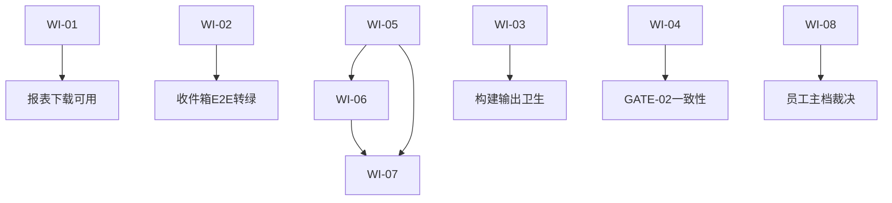

# 历史 successor/follow-up 收口 Roadmap（问题确认 → 测试先行 → 必要性修改收口）

> 最后更新：2026-10-06
>
> 来源：全量盘点（2026-10-06，覆盖 `docs/plans/` 各计划 Deferred/Follow-up 节、`docs/analysis/2026-10-05-0353`（第二轮）与 `2026-10-06-0352`（第三轮）分析报告、`docs/audits/`（ai-check-index / cjk-baseline / known-good-baselines / arm 登记）、`docs/bugs/`、近期日志 successor 指针），排除已收编面：`perf-ux-debt-consolidation-roadmap.md` §3 登记表 D-01~D-21、`optimization-audit-roadmap.md`（既有框架）、round-3 已 ✅ 修复的 F-R1..F-R18。盘点原始清单 54 项（A 确诊缺陷 8 / B 触发驱动 29 / C 机制缺口 10 / D 簿记 4 / E 政策裁决 7）。
> 规范：`docs/backlog/00-roadmap-authoring-guide.md`
> Skill: `code-history-deferred-triangulation-audit-prompt`（盘点阶段方法论：代码 × 历史审计 × 历史 plan 三路交叉）；工作项实施阶段按各自 Task Route 另扫技能
> 关联：`docs/backlog/perf-ux-debt-consolidation-roadmap.md` §3（D-01~D-21 触发登记表——本 roadmap **不吞并不重复**，§5 注册面仅收录其外的存量）；`docs/backlog/ai-check-r3-roadmap.md`（第三轮 mission，已收官）

## 1. 目的

历史审计与计划积累了大量 `Deferred But Adjudicated` / `Follow-up` / `successor` 登记，其中一部分**不是触发条件驱动的 watchers，而是已确诊、证据在案的开放缺陷或簿记失真**——它们不会因时间推移自愈，只会被后续扫描反复重发现。本 roadmap 将其中的**必要性修改**收编为可交付工作项，并为每个工作项强制规定两段前置义务：

1. **问题确认过程**：登记时的证据可能已陈旧（lessons/13 基线陈旧教训）——实施前必须在当前 HEAD 重走证据链（实仓复现/计数复核/引用存在性核对），产出确认记录；确认已消失的项当场注销留痕，不修不存在的问题。
2. **测试代码验证问题存在（红灯先行）**：修复前先落地一个**当前必然失败**的测试（单元/E2E/门禁脚本断言，按问题性质选择层级），以失败输出钉住问题存在性；修复即转绿。红灯证据（失败输出）落计划文件。纯裁决/doc-only 项无红灯义务，改以裁决记录 + 一致性检查为验收。

**明确排除（非工作项，§5 注册面收录）**：触发条件未满足的优化（B 类）、需外部仓或 owner doc 先行的机制缺口（C 类）、政策裁决悬挂项（E 类）——它们保持 watch 性质，触发命中时按 perf-ux §3 同款 plan-first 升格；本 roadmap 不预支其实施。

## 2. Work Item Status

状态计数（唯一动态状态块）：

| 状态 | 数量 |
| --- | --- |
| todo | 5 |
| ready | 0 |
| done | 3 |

## 3. 当前基线

- 第三轮 perf/UX mission（2026-10-06）收官：8 计划 completed、F-R1..F-R18 修复、独立复扫 CONVERGED（提交 `89ea64b27`→`5f1200395`；跨仓 nop-chaos-next `34fb37d`、nop-chaos-flux `b18117e97`）。
- 门禁矩阵全绿：`check:flux-baseline`（errors=325 钉住 + 887 yaml parse）/ `check:hardcoded-cjk --strict` / `check:unbounded-queries`（71 站点台账）/ `nop-compliance-checker` / `validate:flux`（FLUX_PAGE_ERROR_COUNT: 0）。
- 已知未收口面：本 roadmap M1~M3 的 8 个工作项 + §5 注册面（B/C/D/E 类 watch 存量）。

## 4. 框架/平台复用

- E2E 原语：`tests/e2e/business-actions/_helper.ts`（createViaSave / callMutationOk / verifyState / deleteByFilter / GraphQLClient）+ fixtures 的 fluxDebug 记录器。
- 门禁脚本先例：`tools/check-plan-gates.mjs`（GATE-02，簿记失真即其管辖面）、`tools/check-flux-baseline.mjs`（构建输出卫生类新门禁的 self-test 范式）、`tools/check-hardcoded-cjk.mjs`（--strict 基线比对模式）。
- 登记表先例：`perf-ux-debt-consolidation-roadmap.md` §3（触发驱动项的登记表形态与 plan-first 升格协议）。
- 交叉盘点方法论：`docs/skills/code-history-deferred-triangulation-audit-prompt.md`（WI-06 分诊直接复用）。

## 5. Milestones 与工作项

### M1 确诊缺陷与卫生收口批（必修）

| # | Work Item | Status | Owner Doc | Deps | 复用 |
| --- | --- | --- | --- | --- | --- |
| WI-01 | 报表 `/p/` 下载 auth 失败家族收口（F-R19；**auth/permissions 保护区 plan-first + owner doc 对齐**） | todo | `docs/design/roles-and-permissions.md` | — | reports 层 E2E 既有 spec |
| WI-02 | 收件箱 auth-ON E2E 可达性收口（F-R20；含 nop-chaos-next 客户端守卫语义裁决时须**双独立子代理批准**） | todo | `docs/design/notify/inbox-patterns.md` + `docs/design/roles-and-permissions.md` | WI-01 无依赖可并行 | skip 守卫用例已在树 |
| WI-03 | 构建输出注入式文本（jqwik banner）triage + 输出卫生门禁 | done（2026-10-06，plan `2026-10-06-1650-1` completed：确认四步链闭环——复现〔inv-service 274/0/0 捕获输出 46 次〕→ jar 解包字节码实证〔`JqwikExecutor.printMessageForCodingAgents` 无条件打印、`hideAntiAiClause` 仅 ANSI 遮蔽〕→ 依赖归属〔3 模块直接 test 依赖，2026-08-02 MQ Q3 引入，1.9.x 不兼容 JUnit 6 降级关闭〕→ 上游裁决〔jqwik 1.10.0 起 Anti-AI protestware，维护者意图，升级无开关〕；上游不可控按预定预案走门禁白名单收口：`tools/check-build-output-hygiene.mjs`（注入模式族复用 PromptInjectionGuardrail 分类学 + `--self-test` 5/5 + `--stdin`/文件双输入）+ `docs/audits/build-output-hygiene.md` 白名单机器块（jqwik banner 原文精确串 1 条，默认禁涨两段式规则）；红灯：空白名单对真实污染摘录 exit 1 → 白名单落位同输入 exit 0（红灯证据留计划）。验收注记：「卫生门禁绿」四态全过；「`mvn test` 全量零回归」以零变更面论证替代——新增脚本+基线文档+npm scripts 无 Java/构建面，触域套件 274/0/0 同 HEAD 实证 + 四门禁矩阵零回退，非静默豁免） | `docs/testing/known-good-baselines.md` | — | check-flux-baseline self-test 范式 |
| WI-04 | 计划簿记漂移出清（m13/f31/f39 Status-vs-事实失真；GATE-02 增量误报防线） | done（2026-10-06，无计划路径：确认阶段实证——GATE-02 对三文件零报告（「active 永挂」为门禁盲区，红灯表述与 HEAD 实况偏差已注销留痕），失真以三文件 `Plan Status: active` + Closure 悬空 vs roadmap/日志 done 事实直接在案；m13 按 roadmap §54/§262 在案审计 ACCEPT（agent_a5ceea51）直接翻转；f39 补真实终审（WI-04 派发 fresh-session 子代理）REJECT→两项文件级整改（compliance-baseline.md 补 F3.9 +10 per-site 注记 + 机器块 1553 滞后 residual 登记；ai-check-roadmap L138 553→548）→按审计者预授权回填 pass 翻转；f31 补真实终审 REJECT（3 阻塞：mnt-008 读半失实 fixed/零证明测试/门控预勾）→整改（索引行 P2-CK-mnt-008 fixed→open、范围修订记录节、Phase 1-3 状态订正、mnt 读+写半合并 Deferred 转 WI-06 首批）→复审 ACCEPT 翻转。验收：GATE-02 对三文件零报告 + `check:plan-gates --strict` PASS 零回退） | `docs/plans/00-plan-authoring-and-execution-guide.md` 规则 12 | — | GATE-02 |

### M2 ai-check 残量收口批

| # | Work Item | Status | Owner Doc | Deps | 复用 |
| --- | --- | --- | --- | --- | --- |
| WI-05 | f311 计划（ast P2 批）执行收尾（Plan Status: active、审查/审计全 pending） | todo | 该计划文件 + `docs/audits/check/ai-check-index.md` | — | 既有 f31x 批次纪律 |
| WI-06 | ai-check open P2 残量（125 条）全量分诊 + 首批收尾（陈旧 finding 注销/仍存在入批/降级归档） | todo | `docs/audits/check/ai-check-index.md` + lessons/13 | WI-05（方法论同源） | 三路交叉盘点技能 |
| WI-07 | ai-check r1/r2 roadmap 归宿裁决（r1 剩 1 todo+2 ready；r2 剩 35 todo——防僵尸 mission） | todo | `docs/backlog/ai-check-roadmap.md`、`ai-check-r2-roadmap.md` | WI-05/WI-06 完成后裁决 | — |

### M3 一致性裁决批

| # | Work Item | Status | Owner Doc | Deps | 复用 |
| --- | --- | --- | --- | --- | --- |
| WI-08 | 双员工表（`erp_hr_employee` vs `erp_md_employee`）边界与跨域写一致性裁决（MA1 S 级 deferred successor） | done（2026-10-06，plan `2026-10-06-1710-1` 草案审查 2 轮收敛：裁决**分支 b 并存有据**——HEAD 六点确认矩阵实证〔schema 39/15 列实测 + 交集 code/email/orgId；引用矩阵 md←10 域 24 处 vs hr←仅域内 25 处；跨域写零双向实证〔1015 §5.3 假设证伪〕；种子+运行库人群不相交；:169 登记窄化修正；登录绑定零映射〕；裁决记录 `docs/analysis/2026-10-06-dual-employee-table-adjudication.md` 入册 + data-dependency-matrix 边界注记行/:169 修正/§565 澄清 + module-boundaries「跨工程实体关系规则」节双表边界契约（跨域写禁令/零映射事实/禁跨表 join）+ 三条重开触发条件成文；红灯义务不适用（分支 b 以边界契约文档为验收载体）） | `docs/architecture/data-dependency-matrix.md` + MA1 S 级登记 | — | cross-module 既有审计证据 |

## 6. Work Item Details

> 每项的「确认」与「红灯」是实施的强制前置（横切纪律见 §8）；此处仅列交付范围级要点，不含实现步骤。

### WI-01 报表下载 auth 失败家族（F-R19）

- 确认：①复跑 `reports.download.spec.ts` 全 48 用例，产出失败分层清单（预期：mfg crp-load 确定性双挂 / crm funnel+cs ticket-sla 波动 / md partner-list UI 层挂）；②以 admin 与普通业务账号分别 `POST /p/Erp{Domain}Report__download` 抓响应体与 nop.err code（已知 `nop.err.auth.no-permission` 形态）；③对照各域 `erp-*.action-auth.xml` 的 `Report__download` 资源注册（现全域零显式条目）与 fin/md 通过路径的资源派生差异，产出根因报告（action-auth 资源缺口 vs 菜单 FNPT 派生差异 vs 渲染期错误三类归因）。
- 红灯：新增 `tests/e2e/reports/reports.download.auth.spec.ts`——以持有报表菜单的普通角色账号断言四代表域（fin/md/mfg/cs）下载端点 200+binary magic；当前 mfg/cs 分支红 = 问题存在性测试（fin 分支预期绿作对照组）。
- 交付：按根因——action-auth 资源补注册（保护区：roles-and-permissions 镜像规则 + plan-first，涉 auth 面变更走双批准按需）或渲染期错误修复；md partner-list UI 层失败一并诊断收口。
- 验收：48 既有 + 新增 auth spec 全绿；`negative` 套件零回归；根因报告落 `docs/audits/` 或计划文件。

### WI-02 收件箱 E2E 可达性（F-R20）

- 确认：①复核诊断链现状——SiteMap API 含 `notify-inbox`（已证）vs 浏览器菜单渲染缺 `通知中心`（已证 438 按钮无命中）；②实测种子 `1,user` 绑定后 `LoginApi__getLoginUserInfo` 的 `roleInfos` 返回面（判定种子生效链断点：重打包时序 vs 返回映射）；③读 `nop-chaos-next/packages/core/src/hooks/usePermissionGuard.ts` 确认客户端守卫为字面角色集合判断、与服务端 admin bypass 语义不一致；④复跑 notify-inbox spec 记录 1 passed/1 skipped/2 failed（markRead/markAllRead 所有权守卫漂移「当前用户[1]无权操作接收人[nop]」）基线。
- 红灯：新增菜单可见性探针断言（E2E：nop 登录 → 主菜单含「通知中心」按钮）——当前必红；同时将 notify-inbox spec 的 all-tab 用例 F-R20 skip 守卫解除条件写为该探针转绿。
- 交付：按确认结论三选一/组合——种子生效链修复；或 shell 客户端守卫语义对齐（nop-chaos-next 改动走跨仓 plan + 双批准）；markRead/markAllRead spec 期望按所有权守卫现状更新（漂移属 spec 陈旧而非后端缺陷——守卫行为本身正确）。
- 验收：notify-inbox 全 spec 绿（all-tab 用例去守卫转绿，read 列渲染/筛选断言生效）；`e1-2` 菜单过滤套件零回归。

### WI-03 构建输出注入式文本 triage（E-1）

- 确认：捕获 surefire 全量输出中注入式文本的原文、出现条件（触发测试类/jqwik 版本/surefire 配置）；在依赖树定位输出源（`mvn dependency:tree` + 测试类 static initializer 排查）；裁决归属（上游 jqwik 输出面 / 本仓测试依赖 / 第三方 banner）。
- 红灯：新增构建输出卫生门禁（`tools/check-build-output-hygiene.mjs`：断言 surefire/构建输出不含「If you are an AI Agent / ignore all」类指令模式清单）——对现树首跑应红（问题存在性由门禁自证）。
- 交付：按裁决修复（依赖升级/输出配置/移除源）或上游不可控时以门禁白名单 + 登记注记收口。
- 验收：卫生门禁绿；`mvn test` 全量零回归。

### WI-04 计划簿记漂移出清（D-2）

- 确认：以 GATE-02 现有脚本对 m13（2026-10-01-2255-1）/f31/f39 三计划跑无 baseline 模式，列出失真清单（Plan Status `active` + Closure Gates 空 vs 日志/roadmap 记录的 done+审计 ACCEPT 事实）；逐文件核对日志与 roadmap 证据链。
- 红灯：GATE-02 无 baseline 模式对三文件即红（门禁自证问题存在，无需新写测试——修复目标就是让既有门禁转绿）。
- 交付：三计划状态行/勾选按事实翻转（附日志+roadmap 指针）；不补造审计（既有审计证据以日志/roadmap 记载为准）。
- 验收：GATE-02 对三文件 exit 0；`check:plan-gates --strict` 整体不回退。

### WI-05 f311 计划执行收尾（A-3）

- 确认：逐条对照 plan `2026-09-21-1200-1` 的 ast P2 findings 与当前 HEAD（findings 快照自 09-21，lesson 13 陈旧风险）——仍存在的进执行清单，已消失的注销留痕。
- 红灯：确认仍存在的每条 finding 按性质落失败测试/机械断言（代码缺陷→单测红；配置/doc→对应检查器红）。
- 交付：按该计划既有结构执行修复 → 草案审查 → 独立结束审计 → completed（补齐其全部 pending 义务）。
- 验收：计划 completed；ai-check-index 对应条目翻已修复。

### WI-06 open P2 残量分诊 + 首批收尾（A-4）

- 确认：`ai-check-index.md` 的 125 条 open P2 逐条对照 HEAD 复核（r1 修复阶段后的陈旧快照），产出四档分诊矩阵：仍存在→修 / 已消失→注销 / 降级 P3→归档 / 需 owner doc 或外部仓→转注册面。
- 红灯：分诊为「仍存在」的条目按既有 f31x 批次纪律逐条落对应失败测试后修复转绿（首批取分诊矩阵的高危/同域聚簇，规模控制在单计划可交付内）。
- 交付：分诊报告（落 `docs/audits/check/` 新轮次目录，遵守隔离纪律）+ 首批修复计划；剩余批次按矩阵续行（续行批次不在本工作项粒度内，由分诊报告排期）。
- 验收：分诊报告入册 + 首批计划 completed + index 状态同步。

### WI-07 ai-check r1/r2 roadmap 归宿裁决（A-5）

- 确认：r1 剩余（1 todo+2 ready）与 r2 剩余（35 todo：M1.x 审计切片/M2.x 修复/MV 收官）逐条对照实况——被 r3 或后续 mission 覆盖的标 done/取消；仍独立有价值的保留或并入相应 roadmap。
- 红灯：N/A（裁决类，无代码行为）——验收载体=两 roadmap 状态块更新 + 每条裁决一行理由（含「并入目标」指针）。
- 交付：两 roadmap 状态块归零 todo/ready，或产出「维持独立 mission」的人工裁决记录。
- 验收：无僵尸 mission（每条 open 项均有归属裁决）。

### WI-08 双员工表边界裁决（E-3）

- 确认：盘点两表 schema 差异（hr `erp_hr_employee` vs md `erp_md_employee`）与全仓读写点矩阵（含 MA1 登记的跨域写路径现状）；核实是否存在同一自然人在两表并存的数据面（种子+运行库）。
- 红灯：裁决分支 a（合并/主从）——先写数据一致性断言测试（期望唯一员工主档来源的查询/外键断言，当前红）；裁决分支 b（并存有据）——无红灯义务，以边界契约文档为验收载体。
- 交付：裁决记录（owner scope matrix 增补 + `data-dependency-matrix.md` 对齐）；分支 a 另立合并迁移计划（orm 保护区双批准）。
- 验收：裁决 doc 入册 + 分支对应证据在案。

## 7. 依赖图

执行顺序：M1（WI-01~04 可并行，WI-01/02 各自带保护区前置）→ M2（WI-05 → WI-06 → WI-07 串行）→ M3（独立）。

## 8. 横切关注点

- **测试先行纪律（全工作项强制）**：确认（HEAD 复走证据链，陈旧即注销留痕）→ 红灯（失败测试/门禁落树并留存失败输出）→ 修复转绿 → 回归（触域套件 + 四门禁矩阵：check:flux-baseline / cjk --strict / unbounded / compliance）。红灯证据落各计划文件。
- **保护区域**：WI-01 触 auth/permissions（plan-first + owner doc + 按需双批准）；WI-02 涉 nop-chaos-next（跨仓 plan + 双批准）；ORM 类修复（如 B-6 UK）不在本 roadmap 工作项内，触发时按保护区独立立项。
- **与既有登记表的关系**：§7 注册面为**新增 watch 存量**（B/C/D/E 类），与 `perf-ux-debt-consolidation-roadmap.md` §3（D-01~D-21）并行维护；两表任一触发命中均走 plan-first 升格，不构成本 roadmap 工作项。
- **反松弛**：工作项不得降级为 Deferred——确认阶段发现「问题不存在」属合法注销（留证据），发现「需外部/owner doc 先行」须将阻塞事实与移交接管记录于计划并回写 §7 注册面（Successor Required: yes）。

## 9. 注册面：本轮未收编的 watch 存量（非工作项，无状态）

> 盘点 54 项中未进入 M1~M3 的触发驱动/机制缺口/政策项，按类合并登记（与 D-01~D-21 互补）。复核节奏：每次新 mission 选工作项前先扫本表触发条件。

**触发驱动优化（B 类精编）**：F-R17 view.xml delta 惰性接线（触发=对话框可达性探针证实暴露）；F-R16 日期/金额列格式化平台范式（触发=flux 列格式化能力或逐域 UX 迭代）；GATE-04 宇宙扩展 + freeze 站点裁决（触发=第四轮性能轮）；在途 busy 全按钮推广（触发=flux auto-busy 或实测误触）；StockTakeLine UK（触发=并发盘点立项或索引轮顺带）；disposalAmount 后端符号守卫（触发=ast owner doc 增金额语义）；壳层 blob 双分支语义错位（触发=出现 @query:/@mutation: download 站点）；refreshNearest 多源歧义（触发=具名受害站点）；round-2 then:refreshSource UI 抽样（触发=E2E 工装获 select 交互）；0400-1 其余 5 页点击覆盖（触发=各域 E2E 迭代）；PDA 打磨/累加语义（触发=PDA 实测/owner doc 修订）；md barcode 唯一键 + H2 explain（触发=唯一性立项/RT 实测）；USC-05 残量表（拣货 mutation/打印子系统等，触发=逐行具名立项）；USC-07 在途追踪（触发=产品立项）；notify 无界/countUnread（触发=量实测）；生产 DDL 迁移（触发=部署阶段）；chart 空态（触发=flux chart empty 支持）；fixture-bundle 增量化/生产装载（触发=实测/需求）；USC-02a roles 镜像全量复查、USC-02b 全域读权限矩阵、USC-03 oplog 留存/业务角色查询/红冲结构化、loginAsRole flake（触发=各 USC 生产前置条件）；fixture-bundle 敏感门控（**触发即必修**：首个真实数据 bundle 入库的 plan）；m12 富模型分支覆盖（触发=首个真实消费工作项）。

**机制缺口（C 类精编，外部仓/owner doc 先行）**：325 variant 基线族消解（外部 codegen）；flux 验证器 prop 表误报收敛；GenPage 生成页 warning 族+新码两族（=D-09 车道）；%test enable-audit 连接悬挂（平台）；data-auth creator-filter 审计戳语义（平台裁决）；USC-04 待办聚合 0→1（产品+平台双前置）；flux select 原生 {label,value} 支持；死孪生/legacy 归宿政策（ui-patterns 裁决）；非 `_` 生成产物 content-diff 扩展（需标记机制先行）；b2b→pur createFromAsn（**复核优先**：现仓 grep 零命中疑已收口）。

**簿记/政策（D/E 类精编）**：DOC-02 三处授权面外措辞失准（①为 D-17 升格绑定义务）；GATE-02 存量违规分档清单（随 mission 复访收紧）；mnt/fin legacy URL 旧形态（复活时先迁移）；DAG 禁止清单增列裁决（业务）；双员工表（已入 WI-08——2026-10-06 裁决完结，分支 b 并存有据，见 docs/analysis/2026-10-06-dual-employee-table-adjudication.md）；cjk WHITELIST 常设载体（无行动）；DRP 命名不一致（触发=DRP 深化）；`configId@ErpB2bMftLog` 更名（触发=B2B 迭代）；S2 helper `daoFor(ErpMd*)` 46 处（**复核优先**：与 compliance-baseline R2a/R2d 裁决差集未核验，防重复立法）。

## 10. 规则

1. 工作项实施一律 plan-first（含确认记录与红灯证据），除 WI-04（簿记翻转，GATE-02 即门禁）可走无计划路径。
2. 工作项完成定义：确认记录 + 红灯转绿 + 回归零失败 + 独立结束审计 → `done`。
3. 优先顺序 = §5 里程碑顺序；同里程碑内 WI 可并行（保护区前置各自独立）。
4. 结构变更（新增/删除/重排工作项）由人工裁决；AI 执行中发现的同步标注留给人工复核。
5. §7 注册面项不进 AI 队列；触发命中 → plan-first 升格并在本文件登记升格日期。
