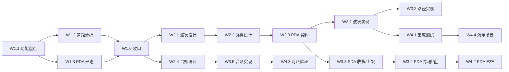

# WMS 仓储管理路线图（WMS Warehouse Roadmap）

> **Last Updated**: 2026-10-28
> **Source**: Gitee GVP 调研 2026-10-28（JeeWMS / GVP 仓储类项目功能盘点）

## 1. 目的

本文件是 WMS 仓储管理能力建设的路线图，对标 JeeWMS/GVP 仓储类项目，覆盖**库内作业**深化：波次管理、拣货路径优化、PDA 手持作业（收货/上架/拣货/盘点/移库）、库存台账细化。本文件遵循 `00-roadmap-authoring-guide.md`：里程碑为分组容器（无状态），只有工作项携带 `todo`/`ready`/`done`。

## 2. Work Item Status

| State | Count |
|-------|-------|
| todo  | 24    |
| ready | 0     |
| done  | 0     |

## 3. 框架/平台复用

| 能力 | 提供方式 |
|------|----------|
| 多仓/批次追溯 | `module-inventory`（3 层模型、批次台账、序列号台账、拣货单头/行、一次性 StockTake） |
| 出入库/运输 | `module-logistics`（发运单、承运商网关 SPI、包裹管理） |
| 移动端交互 | nop-chaos-flux `flux-renderers-mobile`（pull-refresh、infinite-scroll、swipe-cell——PDA 扫码/无限滚动页面载体） |
| 单据状态机 | 域三轴状态分离约定（docStatus/approveStatus/posted，见各域 ORM 模型头注释） |
| 审批流 | `nop-wf` |
| 报表/看板 | `nop-report` + `getDashboardKpi`（AMIS 渲染） |
| 定时/队列 | `nop-job` + `NopSysEvent`（波次释放/补货任务调度） |
| 代码生成 | ORM 源模型唯一真相 → codegen 增量重新生成（`mvn clean install -DskipTests`），不手改生成代码 |

## 4. 当前基线

- **module-inventory**：库存移动单（头/行）、库存流水（不可变）、库存余额（快照）、库存预留单、成本层、调拨单、盘点单（一次性 StockTake）、拣货单（头/行）、批次台账、序列号台账；依赖 app-erp-master-data（物料/仓库/库位）。
- **module-logistics**：发运单（关联采购入库/销售出库）、承运商主数据与配置、承运商网关 SPI、包裹管理、运费双路径过账。
- **缺口**（对照 JeeWMS/GVP）：无波次管理（wave）、无拣货路径优化、无 PDA 作业面（收货/上架/移库的库内作业闭环）、拣货单无路径/分区策略、库存台账缺库位级收发存汇总视图、无周期盘点（已有一次性盘点 + 审计快照设计见 erp-enhancement-roadmap E1.4/E3.2）。

## 5. Milestones

### Milestone W1 — 调研（对标功能盘点 + 能力差距分析）

| Work Item | 状态 | Owner Doc | 依赖 | 复用 |
|-----------|------|-----------|------|------|
| W1.1: JeeWMS/GVP 库内作业功能盘点（波次/路径/PDA/台账矩阵） | todo | `docs/analysis/wms-survey/2026-10-28-jeewms-feature-matrix.md` (NEW) | — | 既有 erp-survey 报告范式 |
| W1.2: module-inventory 现有能力差距分析（拣货单/调拨/盘点 vs WMS 作业面） | todo | `docs/analysis/wms-survey/2026-10-28-gap-analysis.md` (NEW) | W1.1 | inventory ORM 模型注释 |
| W1.3: PDA 端技术形态调研（flux-renderers-mobile 扫码/离线约束） | todo | `docs/analysis/wms-survey/2026-10-28-pda-form-factor.md` (NEW) | W1.1 | nop-chaos-flux |
| W1.4: 阶段深度审计（W1 调研项对照 live repo 核对 contract/实现落地、找 drift） | todo | `docs/audits/2026-XX-multi-audit-wms-w1.md` (NEW) | W1.1-W1.3 | — |
| W1.5: 阶段开放审计（独立 fresh sub-agent 会话开放评审，不复用执行者上下文） | todo | `docs/audits/2026-XX-open-audit-wms-w1.md` (NEW) | W1.4 | — |
| W1.6: 调研结论收口与范围裁决登记 | todo | 本文件 §4 + W1.2 owner doc | W1.4, W1.5 | — |

### Milestone W2 — 设计（数据模型 / API / 边界设计）

| Work Item | 状态 | Owner Doc | 依赖 | 复用 |
|-----------|------|-----------|------|------|
| W2.1: 波次管理数据模型与释放策略设计（wave 头/行、释放规则、与拣货单衔接） | todo | `docs/design/wms/wave-management.md` (NEW) | W1.6 | 拣货单头/行模型、nop-job |
| W2.2: 拣货路径与分区策略设计（路径算法、分区/波次分组、SLOT 化） | todo | `docs/design/wms/pick-path-optimization.md` (NEW) | W2.1 | 库位主数据 |
| W2.3: PDA 作业 API 契约设计（收货/上架/拣货/盘点/移库扫码原子接口 + 幂等） | todo | `docs/design/wms/pda-operation-api.md` (NEW) | W2.2 | action 层即 API、enforcement 栈 |
| W2.4: 库存台账细化设计（库位级收发存汇总视图、批次/序列合并追溯视图） | todo | `docs/design/wms/stock-ledger-views.md` (NEW) | W1.6 | 3 层模型派生视图范式（E3.2 先例） |
| W2.5: 阶段深度审计（设计文档对照 live repo 核对既有 contract/模型引用真实性） | todo | `docs/audits/2026-XX-multi-audit-wms-w2.md` (NEW) | W2.1-W2.4 | — |
| W2.6: 阶段开放审计（独立 fresh sub-agent 会话开放评审设计边界） | todo | `docs/audits/2026-XX-open-audit-wms-w2.md` (NEW) | W2.5 | — |

### Milestone W3 — 开发（原子工作项实施）

| Work Item | 状态 | Owner Doc | 依赖 | 复用 |
|-----------|------|-----------|------|------|
| W3.1: 波次管理实现（wave 实体 + 释放作业 + 波次→拣货单分组） | todo | `wave-management.md` §实现节 | W2.6 | nop-job / codegen |
| W3.2: 拣货路径排序实现（拣货任务行排序 + 分区过滤） | todo | `pick-path-optimization.md` §实现节 | W3.1 | 库位 sequence |
| W3.3: PDA 收货/上架作业实现（扫码 → ASN/上架任务 → 库存写入） | todo | `pda-operation-api.md` §实现节 | W2.6 | module-inventory 移动单、flux-renderers-mobile |
| W3.4: PDA 拣货/移库/盘点作业实现（拣货确认/移库单/盘点行提交） | todo | `pda-operation-api.md` §实现节 | W3.3 | StockTake 链、调拨单 |
| W3.5: 库存台账细化实现（库位级收发存查询 + 台账页面） | todo | `stock-ledger-views.md` §实现节 | W2.6 | 派生视图范式 |
| W3.6: 阶段深度审计 + 阶段开放审计（实现对照设计 contract 找 drift；开放审计独立会话） | todo | `docs/audits/2026-XX-multi-audit-wms-w3.md` + `2026-XX-open-audit-wms-w3.md` (NEW) | W3.1-W3.5 | — |

### Milestone W4 — 验证（集成测试 / E2E / 演示）

| Work Item | 状态 | Owner Doc | 依赖 | 复用 |
|-----------|------|-----------|------|------|
| W4.1: 波次/路径集成测试（释放→分组→拣货确认全链） | todo | W2.1/W2.2 owner doc 验证节 | W3.6 | 既有 JUnit 范式 |
| W4.2: PDA 作业 E2E（flux-renderers-mobile 页面 + 幂等/并发用例） | todo | `pda-operation-api.md` 验证节 | W3.6 | Playwright |
| W4.3: 台账对账验证（库位级汇总 vs 库存流水/余额一致性断言） | todo | `stock-ledger-views.md` 验证节 | W3.6 | E3.2 对账校验范式 |
| W4.4: 演示场景与数据脚本（收货→上架→波次→拣货→发运全流程 demo） | todo | `docs/design/wms/wms-demo-scenario.md` (NEW) | W4.1-W4.3 | app-erp-test-data |
| W4.5: 阶段深度审计（验证覆盖对照 live repo 测试实态核对） | todo | `docs/audits/2026-XX-multi-audit-wms-w4.md` (NEW) | W4.1-W4.3 | known-good-baselines |
| W4.6: 阶段开放审计（独立 fresh sub-agent 会话开放评审验证充分性） | todo | `docs/audits/2026-XX-open-audit-wms-w4.md` (NEW) | W4.5 | — |

## 6. Work Item Details

| Work Item | Deliverables |
|-----------|-------------|
| W1.1 | 对标功能矩阵文档（JeeWMS/GVP 波次、路径、PDA、台账能力逐项登记） |
| W1.2 | 差距分析文档（本仓已有 vs 对标项，逐项立项/不立项裁决建议） |
| W1.3 | PDA 形态注记（扫码 API、离线/断网约束、flux-renderers-mobile 组件匹配表） |
| W1.4/W1.5/W2.5/W2.6/W3.6/W4.5/W4.6 | 审计报告（multi-audit：contract/实现落地核对 + drift 清单；open-audit：独立会话开放评审） |
| W1.6 | 调研结论收口注记（范围裁决、触发条件登记） |
| W2.1 | 波次模型设计（实体/状态机/释放策略/边界，含 ORM 变更清单待授权） |
| W2.2 | 拣货路径设计（算法选型、分区模型、与波次接口） |
| W2.3 | PDA API 契约（原子接口清单、幂等键、错误码、鉴权边界） |
| W2.4 | 台账视图设计（派生视图定义、对账校验项） |
| W3.1-W3.5 | 各设计文档对应实现切片（实体/BizModel/页面/作业），每项一次交付可完成 |
| W4.1-W4.4 | 测试与演示交付物（集成测试、E2E、对账断言、demo 数据脚本） |

## 7. 依赖图

## 8. 横切关注点

- **ORM 授权**：W3.1 波次实体等新增 ORM 变更须在整体计划中显式列出并按 dual-agent-approval 规则执行；优先派生视图/复用既有实体规避 ORM。
- **平台优先**：先核实 nop-job/nop-wf/nop-report 与 flux-renderers-mobile 能力，不重建。
- **审计纪律**：每阶段里程碑内深度审计（对照 live repo）+ 开放审计（fresh sub-agent、不复用执行者上下文）均为强制工作项，不通过不进入下一阶段。
- **状态只在工作项**：里程碑（W1-W4）为分组容器，不携带状态。

## 9. Rules

1. 遵循 `00-roadmap-authoring-guide.md` 状态跟踪；AI 按 Work Item Status 顺序取第一个 `todo` 项执行，不重排优先级。
2. 实施以 `docs/plans/` 计划承载，含独立草案审查与独立结束审计。
3. 发现新复用机会时更新 §3；文档头 Last Updated 随实质更新刷新。
